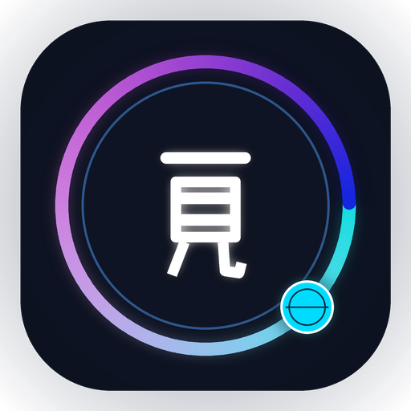
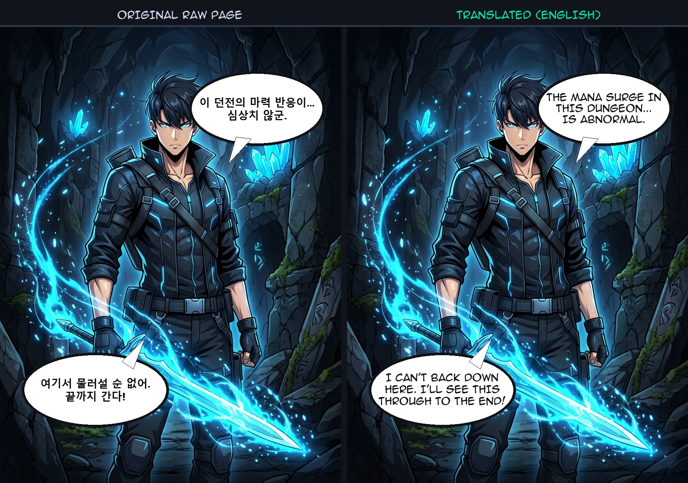
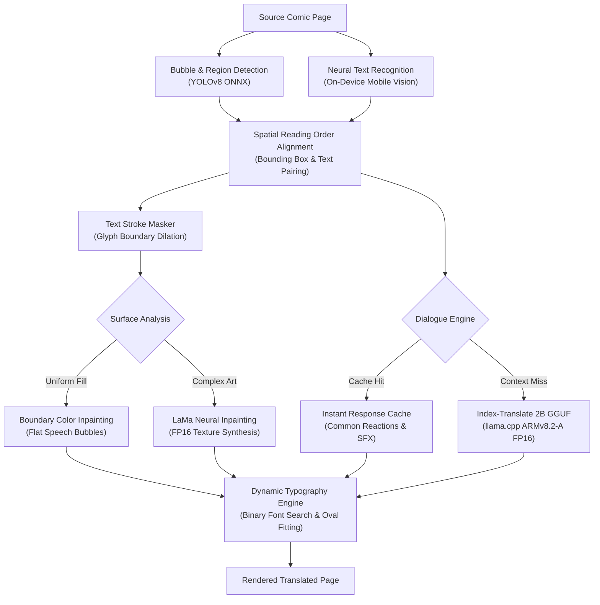

<div align="center">



# Mihon Babel

**On-Device Neural Comic Translation Engine for Android**

[](https://github.com/Deepanshu-sys/mihon-babel/releases)
[](LICENSE.txt)
[](https://developer.android.com)
[](https://developer.arm.com)

<p align="center">
  High-performance offline comic reader with integrated neural OCR, dialogue translation, and automated typesetting.<br/>
  <i>100% On-Device • Zero Cloud Dependencies • Full Data Privacy</i>
</p>

---

</div>

## Visual Showcase

Mihon Babel provides scanlation-grade typesetting, clean bubble segmentation, and context-aware dialogue translation directly on your device:

<div align="center">
  
</div>

---

## Key Features

* **100% Local & Private:** All OCR, bubble detection, dialogue translation, and artwork inpainting execute strictly on-device with zero network requests.
* **Universal Hardware Acceleration:** Built on embedded `llama.cpp` runtime with multi-kernel CPU dispatch (`GGML_CPU_ALL_VARIANTS=ON`), leveraging ARM NEON, ARMv8.2-A FP16, and Arm KleidiAI across modern mobile chipsets.
* **Context-Aware Dialogue Memory:** Automatically preserves character consistency, speaker registers, and narrative continuity across entire chapters.
* **High-Performance Reaction Cache:** Common conversational reactions and recurring short utterances resolve instantaneously via an in-memory cache.
* **Boundary-Preserving Inpainting:** Dual-layer reconstruction using flat background fill with fallback to neural inpainting for textured artwork.
* **Native Reader Integration:** Seamlessly integrated into the reader interface. Background processing via Android WorkManager or on-demand single-tap translation.

---

## Translation Pipeline Architecture



---

## Release Packages

Mihon Babel is distributed in two pre-compiled packages under [GitHub Releases](https://github.com/Deepanshu-sys/mihon-babel/releases/tag/v0.21.3):

| Package Edition | File Name | Size | Architecture | Details |
| :--- | :--- | :--- | :--- | :--- |
| **All-in-One** *(Recommended)* | [`Mihon_Babel_Release_v0.21.3_AllInOne_arm64-v8a.apk`](https://github.com/Deepanshu-sys/mihon-babel/releases/download/v0.21.3/Mihon_Babel_Release_v0.21.3_AllInOne_arm64-v8a.apk) | **~1.59 GB** | `arm64-v8a` | **Standalone Installer.** Pre-bundles the neural translation model weights, inpainter, and detector. Ready to run immediately after installation. |
| **Slim Edition** | [`Mihon_Babel_Release_v0.21.3_Slim_arm64-v8a.apk`](https://github.com/Deepanshu-sys/mihon-babel/releases/download/v0.21.3/Mihon_Babel_Release_v0.21.3_Slim_arm64-v8a.apk) | **~279 MB** | `arm64-v8a` | Lightweight installer bundling detector and inpainter. Model weights load dynamically from external storage. |

### SHA-256 Package Integrity Verification

Verify file authenticity and ensure uncorrupted downloads using SHA-256:

| Package | SHA-256 Hash |
| :--- | :--- |
| `Mihon_Babel_Release_v0.21.3_AllInOne_arm64-v8a.apk` | `58e15fb0564ddf322cd59e0de7ef9068ff9e984541e5bae74408d27e1f98e356` |
| `Mihon_Babel_Release_v0.21.3_Slim_arm64-v8a.apk` | `284d5f793e3d54132206eecf258b0a777b77021eb8272554517e74da17f955f2` |

```bash
# Verify on Linux / macOS
sha256sum -c checksums.sha256

# Verify on Windows (PowerShell)
Get-FileHash -Algorithm SHA256 <package.apk>
```

---

## Quick Setup (Slim Edition)

When using the **Slim Edition**, place the model weights file on your device storage:

1. Download **[index-translate-2b-q4_k_m.gguf](https://huggingface.co/bilibili/Index-Translate)** (~1.3 GB).
2. Move the file into any of the following directories on your device:
   * `/sdcard/MihonModels/index_translate_2b.gguf`
   * `/sdcard/Download/MihonModels/index_translate_2b.gguf`
   * `/sdcard/Android/data/app.mihon.babel/files/models/index_translate_2b.gguf`
3. Open any chapter in the reader and tap the **Translate** icon (🌐).

---

## Frequently Asked Questions

### Is there a Mihon alternative that supports built-in translation?
**Yes.** **Mihon Babel** (`app.mihon.babel`) is an open-source fork designed for on-device comic translation. It translates downloaded chapters directly within the reader without sending data to external servers.

### Can official Mihon translate comics natively?
Standard Mihon does not include a translation pipeline. **Mihon Babel** extends the reader by embedding an on-device neural engine (`llama.cpp`, `Index-Translate`, and `ML Kit`) to process comic dialogue offline.

### How can I translate manga or webtoons offline on Android without cloud APIs?
Install **Mihon Babel** and open any chapter in the reader. Tapping the Translate icon triggers the on-device pipeline, which detects speech bubbles, extracts text, generates translations via `Index-Translate 2B`, cleans artwork surfaces, and formats translated dialogue natively within your device.

### How does on-device translation compare to cloud translation services?
Cloud translation tools require continuous internet access, transmit page images to external servers, and typically require API keys or recurring subscriptions. Mihon Babel runs 100% locally with ARMv8.2-A FP16 neural acceleration, delivering complete data privacy, zero data egress, and scanlation-grade typesetting offline.

### What platforms and hardware are supported?
* **Architecture:** ARM64 Android devices (`arm64-v8a`) with ARMv8.2-A FP16 acceleration.
* **Operating System:** Android 8.0 (API 26) or higher.

---

## Model Licenses & Compliance

All neural models and libraries integrated into Mihon Babel are open-source and legally redistributable under their respective permissive licenses:

| Component | Architecture / Base | License | Terms & Attribution |
| :--- | :--- | :--- | :--- |
| **Index-Translate 2B** | Qwen 2.5 (1.5B/2B) / GGUF | **Apache 2.0** | Permissive open-source license (`bilibili/Index-Translate`). |
| **Comic Text & Bubble Detector** | YOLOv8 / ONNX | **AGPL-3.0 / Open Research** | Comic bubble detection weights (`ogkalu/comic-text-and-bubble-detector`). |
| **LaMa Inpainting** | Large Mask Inpainting (FP16 ONNX) | **Apache 2.0** | Permissive open-source license (`advimman/lama`). |
| **MarianMT / OPUS-MT** | Transformer Seq2Seq | **CC-BY-4.0 / Apache 2.0** | Multilingual translation models by the OPUS project. |
| **Google ML Kit OCR** | Mobile Vision On-Device SDK | **Google APIs TOS** | Officially licensed for redistribution within Android applications. |

> **Note on Model Distribution:** The 1.3 GB model weights are distributed via **GitHub Releases** (which supports up to 2 GB binary assets per release) to comply with standard GitHub repository limits.

---

## Building from Source

### Prerequisites
* Android Studio Ladybug (or newer)
* Android SDK 36, NDK 27.2.12479018
* CMake 3.31.6+
* JDK 17 or JDK 21

### Build Release APKs
```bash
# Clone the repository
git clone https://github.com/Deepanshu-sys/mihon-babel.git
cd mihon-babel

# Build Release APK
./gradlew :app:assembleRelease
```

---

## Acknowledgements

* **[Mihon](https://github.com/mihonapp/mihon):** The premier open-source manga reader for Android (Apache License 2.0).
* **[llama.cpp](https://github.com/ggml-org/llama.cpp):** LLM inference in C/C++ by Georgi Gerganov and contributors (MIT License).
* **[Index-Translate](https://github.com/bilibili/Index-Translate):** High-quality comic translation model by Bilibili.
* **[LaMa Inpainting](https://github.com/advimman/lama):** Resolution-robust large mask inpainting.
